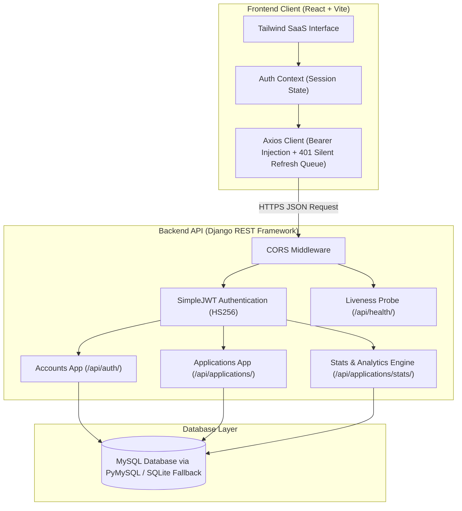
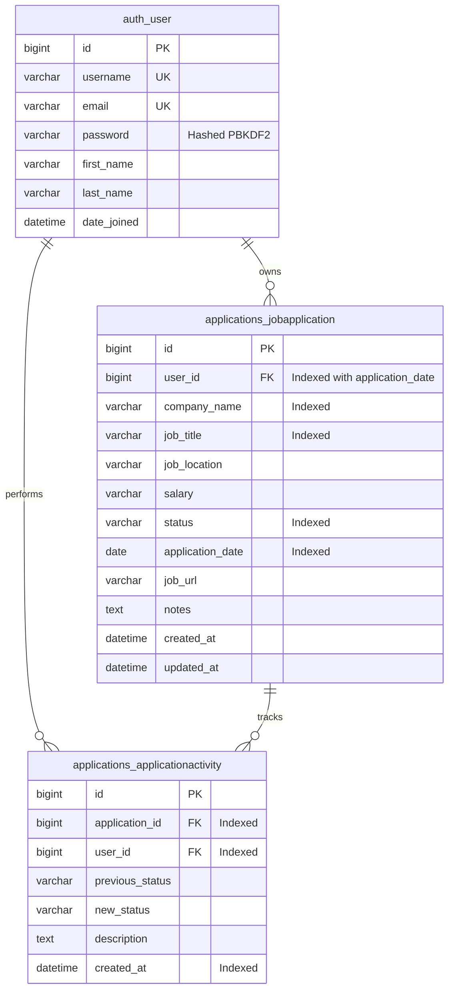

# JobTrack — Job Application Tracker & Career Pipeline

[](https://opensource.org/licenses/MIT)
[](https://www.python.org/)
[](https://www.djangoproject.com/)
[](https://react.dev/)
[](https://tailwindcss.com/)
[](https://www.mysql.com/)

A modern, production-quality, full-stack SaaS web application designed to track, organize, and visualize the complete lifecycle of job and internship applications. Built with a decoupled client-server architecture utilizing **Django REST Framework**, **PyMySQL**, **React (Vite)**, **Tailwind CSS**, and **Recharts**.

---

## Table of Contents
1. [Project Overview](#1-project-overview)
2. [Problem Statement & Solution](#2-problem-statement--solution)
3. [Key Features](#3-key-features)
4. [Technology Stack](#4-technology-stack)
5. [System Architecture](#5-system-architecture)
6. [Directory & Folder Structure](#6-directory--folder-structure)
7. [Database Schema & Entity Relationships](#7-database-schema--entity-relationships)
8. [API Endpoint Catalog](#8-api-endpoint-catalog)
9. [Authentication & Security Architecture](#9-authentication--security-architecture)
10. [Local Installation & Setup](#10-local-installation--setup)
11. [Environment Variables](#11-environment-variables)
12. [Database Setup & MySQL Configuration](#12-database-setup--mysql-configuration)
13. [Testing & Quality Assurance](#13-testing--quality-assurance)
14. [Deployment Architecture](#14-deployment-architecture)
15. [User Interface & Screenshots](#15-user-interface--screenshots)
16. [Live Application URL](#16-live-application-url)
17. [GitHub Repository](#17-github-repository)
18. [Demo Video](#18-demo-video)

---

## 1. Project Overview

**JobTrack** provides early-career developers, software engineering interns, and full-time job seekers with a centralized command center to streamline their employment search. Instead of scattered spreadsheets or messy notes, JobTrack delivers dynamic pipeline visualizations, stage-by-stage audit trails, multi-criteria filtering, and automated interview-to-offer conversion metrics.

---

## 2. Problem Statement & Solution

### The Problem
During job hunting seasons, candidates apply to dozens or hundreds of positions across various platforms (LinkedIn, Handshake, referrals, company portals). Spreadsheets lack:
- Automated metric aggregations and conversion funnel calculations.
- Historical audit trails of when statuses changed.
- Real-time search, sorting, and stage-specific action workflows.
- Mobile accessibility and structured note-taking.

### The Solution
JobTrack solves this with:
- **Stateless JWT Security**: Multi-tenant data isolation guaranteeing users only ever see their own records.
- **Dynamic ORM Analytics**: Server-side aggregation engine that computes KPI stats, interview rates, offer conversion percentages, and monthly submission cadences.
- **Atomic Timeline Auditing**: Automatic logging of every status transition with timestamps and optional interview notes.
- **Sleek SaaS Dashboard**: Built with Tailwind CSS, featuring SVG charts (Recharts) and skeleton loaders.

---

## 3. Key Features

- **Authentication & Profile Management**:
  - Secure registration, login, profile updates, and password changes.
  - JWT token rotation with server-side refresh-token blacklisting upon logout.
- **Interactive Analytics Dashboard**:
  - 5 real-time KPI cards: *Total Applications*, *In Progress*, *Interviews Scheduled*, *Offers Received*, and *Rejections*.
  - Status Distribution Recharts Doughnut chart with custom percentage tooltips.
  - Monthly application timeline bar chart showing submission velocity.
  - Live activity feed showing recent status changes.
- **Application Pipeline Management**:
  - Responsive data table displaying company initial avatar, company name, role, location, salary, date applied, status badge, and job link.
  - Status filter tabs with dynamic counts (`All`, `Applied`, `Under Review`, `Shortlisted`, `Interview Scheduled`, `Offered`, `Rejected`).
  - Real-time search query on company, role, location, and notes.
  - Server-side sorting and pagination.
- **Status Activity Timeline**:
  - Dedicated audit drawer showing the full chronological lifecycle of an application (Initial creation $\rightarrow$ Screen $\rightarrow$ Interview $\rightarrow$ Offer/Rejection).
- **Responsive Layout & Visual Polish**:
  - Collapsible dark-mode sidebar, sticky header with live backend API health probe, loading skeletons, and confirmation dialogs.

---

## 4. Technology Stack

### Backend
- **Framework**: Python 3.11+ / Django 5.1+ / Django 6.0
- **REST Framework**: Django REST Framework (DRF) 3.15+
- **Authentication**: `djangorestframework-simplejwt` with `token_blacklist`
- **Database Connector**: `PyMySQL` (Pure-Python MySQL DB-API v2.0 client)
- **CORS Handling**: `django-cors-headers`
- **Environment Management**: `python-dotenv`

### Frontend
- **Library / Runtime**: React 18 (SPA)
- **Build Tool**: Vite 5
- **Routing**: React Router v6
- **Styling**: Tailwind CSS 3.4 with custom typography and component tokens
- **Icons**: Lucide React
- **Data Visualizations**: Recharts (SVG Pie & Bar charts)
- **HTTP Client**: Axios with request and response interceptors
- **Notifications**: React Hot Toast

---

## 5. System Architecture



---

## 6. Directory & Folder Structure

```
JobTrack/
├── .gitignore                     # Production Git exclusion rules
├── README.md                      # Comprehensive technical documentation
├── backend/
│   ├── .env                       # Local environment variables (excluded from Git)
│   ├── .env.example               # Template environment configuration
│   ├── manage.py                  # Django CLI runner
│   ├── requirements.txt           # Python dependency manifest
│   ├── db.sqlite3                 # Local SQLite database (excluded from Git)
│   ├── jobtrack_api/              # Project core configuration
│   │   ├── __init__.py            # PyMySQL driver registration
│   │   ├── settings.py            # SimpleJWT, Blacklist, CORS, Logging, DB router
│   │   ├── urls.py                # Root router & health check
│   │   ├── views.py               # Liveness & database connectivity probe
│   │   ├── wsgi.py
│   │   └── asgi.py
│   ├── accounts/                  # User accounts & authentication app
│   │   ├── apps.py
│   │   ├── serializers.py         # Registration, Profile, Password serializers
│   │   ├── views.py               # Register, Login, Logout, Profile views
│   │   ├── urls.py                # /api/auth/ routing
│   │   └── tests.py               # 11 unit & integration tests
│   └── applications/              # Application tracking core app
│       ├── apps.py
│       ├── models.py              # JobApplication & ApplicationActivity models
│       ├── serializers.py         # Field validators & activity serializers
│       ├── views.py               # Atomic ModelViewSet & stats actions
│       ├── urls.py                # /api/applications/ routing
│       ├── management/
│       │   └── commands/
│       │       └── seed_demo_data.py # Demo database population utility
│       ├── migrations/
│       └── tests.py               # 21 CRUD, validation, isolation, sorting tests
│
└── frontend/                      # Client SPA (React + Vite)
    ├── .env                       # Client environment variables (excluded from Git)
    ├── .env.example
    ├── index.html                 # HTML shell with Google Fonts
    ├── package.json               # Frontend dependencies & scripts
    ├── vite.config.js             # Vite configuration with chunk splitting
    ├── tailwind.config.js         # Styling tokens & brand color palette
    ├── postcss.config.js
    └── src/
        ├── main.jsx               # Application entry point
        ├── App.jsx                # Router, AuthProvider, Toaster container
        ├── index.css              # Tailwind base & custom scrollbar directives
        ├── api/
        │   ├── axios.js           # Centralized Axios client & refresh queue
        │   ├── auth.js            # Auth API service methods
        │   └── applications.js    # Job application service methods
        ├── context/
        │   └── AuthContext.jsx    # User session state & toast handlers
        ├── components/
        │   ├── common/            # Button, Input, Modal, Badge, StatCard, Skeletons
        │   ├── layout/            # AppLayout, Sidebar, Topbar, ProtectedRoute
        │   ├── dashboard/         # StatusPieChart, TimelineChart, RecentActivityFeed
        │   └── applications/      # ApplicationTable, ApplicationModal, DeleteModal, TimelineModal
        ├── pages/
        │   ├── Dashboard.jsx      # Analytics dashboard
        │   ├── Applications.jsx   # Applications management page
        │   ├── Profile.jsx        # Account settings & password change
        │   ├── Login.jsx          # Sign-in page
        │   ├── Register.jsx       # Sign-up page
        │   └── NotFound.jsx       # 404 handler
        └── utils/
            ├── constants.js       # Status configurations & color definitions
            └── formatters.js      # Date & relative time helpers
```

---

## 7. Database Schema & Entity Relationships



---

## 8. API Endpoint Catalog

### System Probe
| Method | Endpoint | Permissions | Description |
| :--- | :--- | :--- | :--- |
| `GET` | `/api/health/` | Public | Readiness probe verifying API and DB connection |

### Authentication (`/api/auth/`)
| Method | Endpoint | Permissions | Request Body / Query | Description |
| :--- | :--- | :--- | :--- | :--- |
| `POST` | `/api/auth/register/` | Public | `{ username, email, password, password_confirm, first_name, last_name }` | Register new user; returns JWT token pair |
| `POST` | `/api/auth/login/` | Public | `{ username, password }` | Authenticate; returns `{ access, refresh, user }` |
| `POST` | `/api/auth/token/refresh/` | Public | `{ refresh }` | Rotate refresh token and issue new access token |
| `POST` | `/api/auth/logout/` | Authenticated | `{ refresh }` | Blacklist refresh token to revoke session |
| `GET` | `/api/auth/profile/` | Authenticated | *None* | Retrieve current authenticated user profile |
| `PATCH` | `/api/auth/profile/` | Authenticated | `{ first_name, last_name, email }` | Update personal account details |
| `POST` | `/api/auth/change-password/` | Authenticated | `{ old_password, new_password, new_password_confirm }` | Change account password |

### Job Applications (`/api/applications/`)
| Method | Endpoint | Permissions | Parameters / Description |
| :--- | :--- | :--- | :--- |
| `GET` | `/api/applications/` | Authenticated | `?search=google&status=INTERVIEW&ordering=-application_date&page=1` |
| `POST` | `/api/applications/` | Authenticated | `{ company_name, job_title, status, salary, application_date, job_url, notes }` |
| `GET` | `/api/applications/{id}/` | Authenticated | Retrieve single application (Owner-only) |
| `PATCH` | `/api/applications/{id}/` | Authenticated | Partial update; logs activity if status changed |
| `DELETE` | `/api/applications/{id}/` | Authenticated | Permanently delete application & cascade activities |
| `GET` | `/api/applications/{id}/activities/` | Authenticated | Retrieve status transition history for an application |
| `GET` | `/api/applications/stats/` | Authenticated | Real-time ORM KPIs, status breakdown, rates & trend |

---

## 9. Authentication & Security Architecture

1. **Stateless JWT with Token Rotation**:
   - Access tokens have a 60-minute lifespan.
   - Refresh tokens rotate upon every refresh call.
   - The revoked refresh token's unique identifier (`jti`) is added to Django's `token_blacklist` table. Any reuse attempt immediately fails.
2. **Multi-Tenant User Isolation**:
   - All querysets enforce `filter(user=request.user)`.
   - Any attempt to query, edit, or delete another user's ID yields **HTTP 404 Not Found**, preventing user enumeration.
3. **Storage & XSS Trade-Off Analysis**:
   - Access tokens are held in-memory during active sessions and synchronized with `localStorage` for cross-tab persistence.
   - *Security Trade-Off*: Storing tokens in `localStorage` carries an XSS exposure risk if malicious scripts execute. JobTrack mitigates this with short token lifespans, server-side token rotation, and React's automatic JSX escaping. For enterprise deployments, the recommended upgrade path is moving the refresh token to an `HttpOnly`, `SameSite=Strict` cookie paired with CSRF verification.
4. **Input Validation**:
   - Regex-based salary validation rejects negative values and malformed strings while supporting flexible formats (`$95,000`, `120k`, `$50/hr`, `Competitive`).
   - URLs enforce valid HTTP/HTTPS schemes. Dates cannot exceed the current calendar date.

---

## 10. Local Installation & Setup

### Prerequisites
- Python 3.11+
- Node.js 18+ and npm
- Git

### 1. Clone the Repository
```bash
git clone https://github.com/abdul-abd17/JobTrack.git
cd JobTrack
```

### 2. Backend Setup
```bash
# Navigate to backend directory
cd backend

# Create and activate a Python virtual environment
python -m venv venv
# On Windows:
venv\Scripts\activate
# On macOS/Linux:
source venv/bin/activate

# Install dependencies
pip install -r requirements.txt

# Create .env file from template
copy .env.example .env     # Windows
cp .env.example .env       # macOS/Linux

# Apply database migrations
python manage.py migrate

# (Optional) Seed realistic demo dataset
python manage.py seed_demo_data --clear

# Start the Django development server
python manage.py runserver 127.0.0.1:8000
```

### 3. Frontend Setup
```bash
# In a new terminal, navigate to the frontend directory
cd frontend

# Install dependencies
npm install

# Create .env file from template
copy .env.example .env     # Windows
cp .env.example .env       # macOS/Linux

# Start Vite development server
npm run dev
```

Visit `http://localhost:5173` in your browser.

---

## 11. Environment Variables

### Backend (`backend/.env`)
| Variable | Default Value | Description |
| :--- | :--- | :--- |
| `SECRET_KEY` | *Secret String* | Cryptographic signing key |
| `DEBUG` | `True` | Set to `False` in production |
| `ALLOWED_HOSTS` | `localhost,127.0.0.1` | Comma-separated list of allowed host headers |
| `CORS_ALLOWED_ORIGINS` | `http://localhost:5173,http://127.0.0.1:5173` | Allowed frontend origins |
| `USE_SQLITE_FALLBACK` | `True` | Set to `False` to use MySQL |
| `DB_NAME` | `jobtrack_db` | MySQL database name |
| `DB_USER` | `root` | MySQL database username |
| `DB_PASSWORD` | `""` | MySQL database password |
| `DB_HOST` | `127.0.0.1` | MySQL database host |
| `DB_PORT` | `3306` | MySQL database port |

### Frontend (`frontend/.env`)
| Variable | Default Value | Description |
| :--- | :--- | :--- |
| `VITE_API_BASE_URL` | `http://localhost:8000/api` | Base URL of Django REST API |

---

## 12. Database Setup & MySQL Configuration

By default, `USE_SQLITE_FALLBACK=True` allows immediate local development using SQLite (`backend/db.sqlite3`).

### Switching to MySQL
1. Install and start MySQL Server (or start a Docker container):
   ```bash
   docker run --name jobtrack-mysql -e MYSQL_ROOT_PASSWORD=secret -e MYSQL_DATABASE=jobtrack_db -p 3306:3306 -d mysql:8.0
   ```
2. Update `backend/.env`:
   ```ini
   USE_SQLITE_FALLBACK=False
   DB_ENGINE=django.db.backends.mysql
   DB_NAME=jobtrack_db
   DB_USER=root
   DB_PASSWORD=secret
   DB_HOST=127.0.0.1
   DB_PORT=3306
   ```
3. Run migrations:
   ```bash
   python backend/manage.py migrate
   ```
*PyMySQL is pre-configured in `backend/jobtrack_api/__init__.py` to act as the primary MySQL driver.*

---

## 13. Testing & Quality Assurance

JobTrack includes an automated test suite covering authentication, CRUD operations, input validation, status activity timeline generation, and multi-tenant data isolation.

### Running Backend Tests
```bash
python backend/manage.py test accounts applications -v 2
```
**Test Results (32 Tests Passed):**
```
Ran 32 tests in 22.900s
OK
Destroying test database for alias 'default'...
System check identified no issues (0 silenced).
```

### Running Frontend Production Build
```bash
npm run build --prefix frontend
```
**Build Output:**
```
✓ 2280 modules transformed.
dist/index.html                   1.16 kB
dist/assets/index-V2u9nDaQ.css   38.50 kB
dist/assets/icons-C0G8NinQ.js    15.28 kB
dist/assets/index-B5T_M9FS.js    85.43 kB
dist/assets/vendor-IRhq7YeK.js  223.41 kB
dist/assets/charts-Bd4bt5FE.js  412.93 kB
✓ built in 3.01s
```

---

## 14. Deployment Architecture

JobTrack is designed for production deployment on platforms such as Render, Railway, AWS, or DigitalOcean:

```
[Users / Browsers] 
       │
       ▼
[Cloudflare / CDN] (SSL Termination & Static Asset Caching)
       │
       ├───> [Frontend Host (Vercel / Netlify / S3)] ──> Serves compiled Vite SPA
       │
       └───> [Backend API (Gunicorn / Uvicorn on Docker)]
                   │
                   ├──> [SimpleJWT Token Blacklist & Auth Engine]
                   └──> [Managed MySQL Database (AWS RDS / PlanetScale)]
```

### Production Checklist
1. Set `DEBUG=False` in `backend/.env`.
2. Configure strong `SECRET_KEY`.
3. Set `ALLOWED_HOSTS` to your production domain (e.g., `api.jobtrack.dev`).
4. Set `CORS_ALLOWED_ORIGINS` to your frontend domain (e.g., `https://jobtrack.dev`).
5. Run `python manage.py collectstatic` to gather static files.

---

## 15. User Interface & Screenshots

### Dashboard Overview
*Interactive statistics cards, Recharts status distribution doughnut, monthly trend chart, and recent activity feed.*
*(Screenshot Placeholder: Add dashboard image here)*

### Applications Management Table
*Applications table with search, status filtering tabs, sorting, pagination, and action controls.*
*(Screenshot Placeholder: Add applications table image here)*

### Add / Edit Application Modal
*Accessible modal form with client validation, date picker, status choices, and optional timeline notes.*
*(Screenshot Placeholder: Add modal image here)*

### Status Activity Timeline
*Detailed audit drawer showing timestamped status transitions for an application.*
*(Screenshot Placeholder: Add activity timeline image here)*

---

## 16. Live Application URL
- **Live Demo**: `[Coming Soon / Deployment Pending]`

---

## 17. GitHub Repository
- **Repository URL**: `https://github.com/abdul-abd17/JobTrack`

---

## 18. Demo Video
- **Walkthrough Video**: `[Coming Soon / Link Pending]`

---

## License
This project is open-source and available under the [MIT License](LICENSE).

